# How the code of tracker-top works

A guided tour of the source code, for someone who has written some code (Python, VBA, MATLAB,
JavaScript…) but does not write Rust for a living. It explains what each part does, shows the
important pieces of code and draws the flow of data with diagrams. Read it in order the first
time; afterwards, use it as a map.

You do not need to know Rust beforehand: chapter 3 teaches just enough of it to read this code,
using examples taken from the code itself. If you already know Rust, skip chapter 3.

**Contents**

1. [What the program does](#1-what-the-program-does)
2. [The pieces and how they fit together](#2-the-pieces-and-how-they-fit-together)
3. [Just enough Rust to read this code](#3-just-enough-rust-to-read-this-code)
4. [top-core: the optimiser](#4-top-core-the-optimiser)
5. [top-db: the master database](#5-top-db-the-master-database)
6. [top-app: the desktop program](#6-top-app-the-desktop-program)
7. [top-web: the browser version](#7-top-web-the-browser-version)
8. [The web page (JavaScript)](#8-the-web-page-javascript)
9. [Tests](#9-tests)
10. [Building, continuous integration and releases](#10-building-continuous-integration-and-releases)
11. [Recipes: how do I…](#11-recipes-how-do-i)
12. [Glossary](#12-glossary)

File paths in this guide are relative to the repository root, e.g. `crates/top-core/src/qp.rs`.
Line numbers are not given because they change; search for the function name instead.

---

## 1. What the program does

On a solar farm with single-axis trackers, each tracker is a row of piles (posts) driven into the
ground; a torque tube carrying the solar modules rests on the tops of the piles. The program
decides **how high the top of each pile must be** (its *top of pile*, ToP) so that:

- each pile sticks out of the ground by an amount within the allowed **reveal window**
  (e.g. 1.20 m to 1.60 m);
- the tube bends very little from one span to the next: the **angle change** between two
  consecutive spans stays under the tracker manufacturer's limit (0.75°, 0.70° with margin);
- where the ground does not allow both, the ground is **cut or filled** as little as possible;
- piles in flood areas keep their top **above the flood level** (plus a clearance).

Around that calculation, the program keeps a **database** of the project:

- the **master pile list** (the design: pile IDs, coordinates, pile types, colours), which can
  never be changed;
- every **survey file** received from the field (real ground elevation at each pile), every
  LIDAR / design ground file and every flood file, with an import report;
- every **optimisation run** and its results.

It then shows results (tables, profile charts, a 3D view), exports them (Excel, CSV, ArcGIS
GeoPackage), works out the new **set-out position** of each pile (so that the torque-tube spans
keep their design length), writes **files for the installers** when a block is complete, and can
**share one database** between several computers through Google Drive.

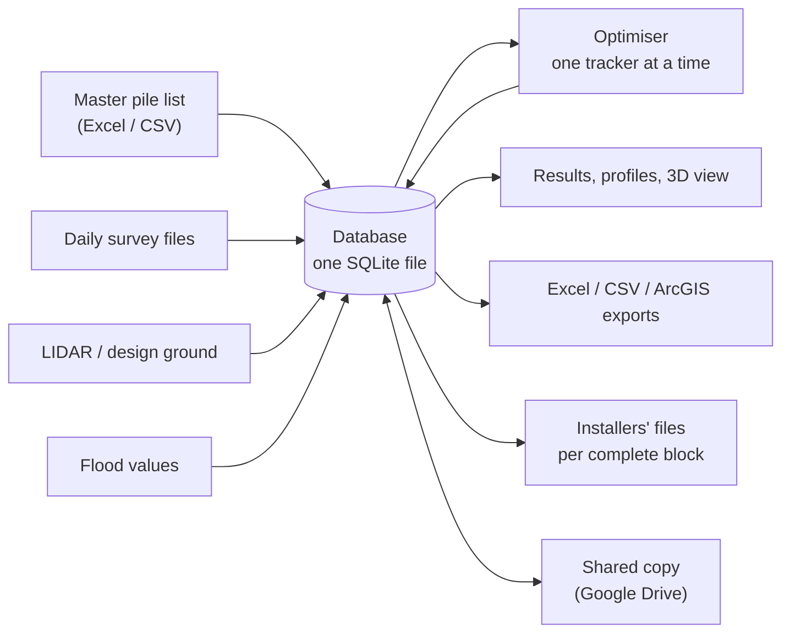

---

## 2. The pieces and how they fit together

The code is a Rust **workspace**: one repository holding several **crates** (Rust's word for a
library or a program). Each crate has its own folder under `crates/`.

| Crate | Kind | What it is |
|---|---|---|
| `top-core` | library | The optimiser: data model, the maths, the solver, set-out. No database, no files except CSV. No external dependencies. |
| `top-cli` | program `top` | The original command-line optimiser: CSV in, CSV out. |
| `top-db` | library | The master database (SQLite): imports, matching survey points to piles, running the optimiser, exports, installers' files, sharing. Also the **request handler** used by both user interfaces. |
| `top-app` | program `tracker-top` | The desktop program: a small local web server plus the web page (HTML/CSS/JavaScript, compiled into the executable). |
| `top-web` | library compiled to WebAssembly | The browser version: `top-db` and `top-core` compiled to run inside a web page. |

Who uses whom (an arrow means "uses"):

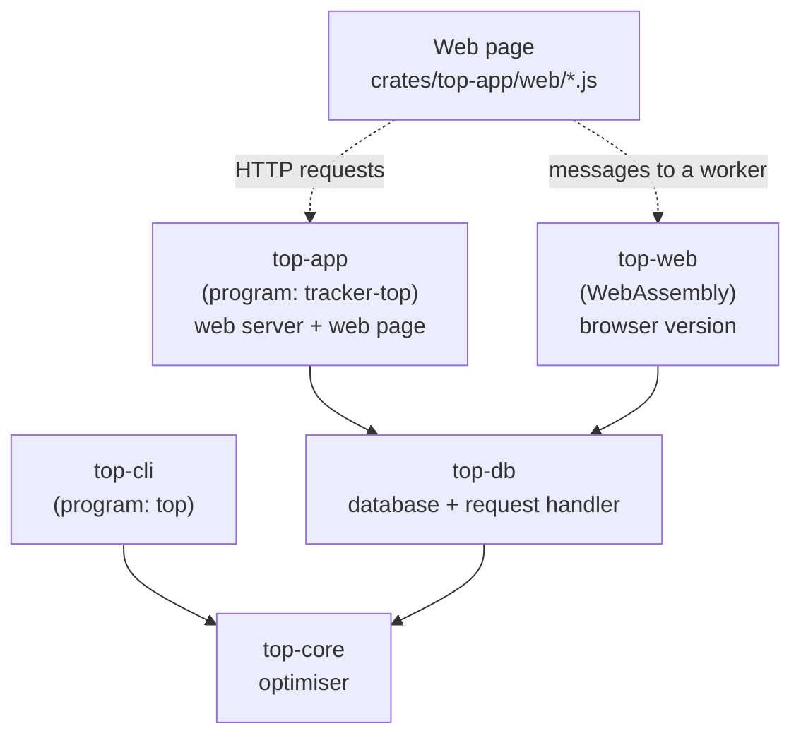

The key design idea: **one web page, one request handler, two ways to run it.** The page sends
the same requests (`GET api/summary`, `POST api/import?kind=survey`, …) in both cases:

- in the **desktop program**, the requests go over HTTP to the local server (`top-app`), which
  passes them to `top_db::api::handle`;
- in the **browser version**, a small JavaScript bridge (`browser.js`) passes them to the same
  `top_db::api::handle`, compiled to WebAssembly and running in a background thread of the browser
  (a *worker*).

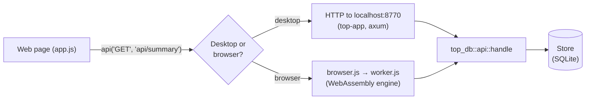

### Folder tour

| Path | Contents |
|---|---|
| `Cargo.toml` | The workspace: list of crates, shared version number, shared dependencies. |
| `Cargo.lock` | Exact versions of every external library (generated; commit it). |
| `crates/top-core/src/model.rs` | `Pile`, `Tracker`, grouping piles into trackers. |
| `crates/top-core/src/params.rs` | Design parameters (reveal window, angle limit…) and their defaults. |
| `crates/top-core/src/optimize.rs` | Builds the optimisation problem of a tracker, solves it, checks it, gives a status. |
| `crates/top-core/src/qp.rs` | The quadratic-programming solver (ADMM). |
| `crates/top-core/src/setout.rs` | New pile positions that keep the torque-tube span lengths. |
| `crates/top-core/src/csv.rs` | CSV reading/writing for the command-line tool. |
| `crates/top-cli/src/main.rs` | The `top` command. |
| `crates/top-db/src/schema.sql` | The database tables and the rules (triggers) that protect them. |
| `crates/top-db/src/store.rs` | `Store`: opening the database, importing files, optimising, reading the current state, summary. The biggest file. |
| `crates/top-db/src/table.rs` | Reading CSV/TXT/Excel files into rows of text; finding columns by name. |
| `crates/top-db/src/report.rs` | The import report (findings: errors, warnings, info). |
| `crates/top-db/src/dates.rs` | Finding a date in a file name or a cell. |
| `crates/top-db/src/settings.rs` | Project settings stored in the database. |
| `crates/top-db/src/export.rs` | Excel and CSV exports, export columns and profiles. |
| `crates/top-db/src/gpkg.rs` | GeoPackage export for ArcGIS / QGIS. |
| `crates/top-db/src/blocks.rs` | Which blocks are complete; the installers' files. |
| `crates/top-db/src/sync.rs` | Sharing one database between computers: revisions, merging. |
| `crates/top-db/src/api.rs` | The request handler shared by the desktop and browser versions. |
| `crates/top-app/src/main.rs` | Start-up of the desktop program (arguments, database, web server). |
| `crates/top-app/src/api.rs` | HTTP routes of the desktop program. |
| `crates/top-app/src/watch.rs` | The watch folder (automatic import of new survey files). |
| `crates/top-app/src/assets.rs` | The web page's files, built into the executable. |
| `crates/top-app/web/` | The web page: `index.html`, `style.css`, `app.js` (the interface), `sync.js` (shared database), `view3d.js` (3D view), `profile.js` (profile chart), `config.js`, `vendor/` (three.js, delaunator). |
| `crates/top-web/src/lib.rs` | The browser engine exposed to JavaScript. |
| `crates/top-web/www/` | `worker.js` (runs the engine, stores the database in the browser) and `browser.js` (bridge between the page and the worker). |
| `scripts/build-web.sh` | Builds the browser version into `target/web-dist/`. |
| `.github/workflows/` | Automatic builds and tests on GitHub (`build.yml`), publication of the browser version (`pages.yml`). |
| `testdata/` | A small synthetic pile list used by the tests. |

---

## 3. Just enough Rust to read this code

Rust is a compiled language, like C or C++, but with rules that make most memory and
concurrency mistakes impossible: if it compiles, a whole class of crashes cannot happen. The price
is a few concepts that other languages do not have (*ownership* and *borrowing*). This chapter
explains the parts you will meet in this code.

### 3.1 Cargo, crates and modules

`cargo` is Rust's build tool and package manager (like `pip` + `make`). Each crate has a
`Cargo.toml` listing its dependencies:

```toml
# crates/top-db/Cargo.toml (excerpt)
[dependencies]
top-core.workspace = true      # another crate of this workspace
rusqlite = { version = "0.41", features = ["bundled", "serialize", "backup"] }
rust_xlsxwriter = "0.102"      # writes Excel files
```

Inside a crate, each `.rs` file is a **module**. `lib.rs` (for a library) or `main.rs` (for a
program) declares them:

```rust
// crates/top-db/src/lib.rs
pub mod api;      // the file api.rs, visible from outside the crate ("pub")
pub mod store;
pub use store::{Store, State};   // re-export: other crates can write top_db::Store
```

`use` brings names into scope, like Python's `import`:

```rust
use crate::settings::Settings;            // from this crate
use top_core::{Pile, Tracker, optimize_all};   // from another crate
use std::collections::HashMap;            // from Rust's standard library
```

Only items marked `pub` can be used from outside their module; `pub(crate)` means "visible
anywhere in this crate, but not outside it".

### 3.2 Variables and types

```rust
let n = tracker.piles.len();          // a constant: cannot be reassigned
let mut acc = 0.0;                    // "mut": can change
acc += 8.0;
let z_ref: f64 = 51.2;                // type written explicitly (usually inferred)
```

Types you will see everywhere:

| Type | Meaning |
|---|---|
| `f64` | a floating-point number (64-bit), used for every coordinate and elevation |
| `i64`, `usize` | integers (`usize` is used for counts and indexes) |
| `bool` | `true` / `false` |
| `String` | a text the variable owns (can grow) |
| `&str` | a borrowed view of some text (see 3.4) |
| `Vec<T>` | a growable list of `T`, e.g. `Vec<f64>`; `vec![0.0; n]` makes `n` zeros |
| `&[T]` | a borrowed view of a list (a *slice*) |
| `HashMap<K, V>`, `BTreeMap<K, V>` | dictionaries (`BTreeMap` keeps its keys sorted) |
| `Option<T>` | either `Some(value)` or `None`: Rust has no `null` (see 3.5) |
| `Result<T, E>` | either `Ok(value)` or `Err(error)` (see 3.5) |

### 3.3 Structs, enums and methods

A **struct** groups named fields (like a class without inheritance, or a Python dataclass):

```rust
// crates/top-core/src/model.rs
pub struct Pile {
    pub name: String,
    pub tracker: String,
    pub easting: f64,
    pub northing: f64,
    pub z_lidar: f64,             // ground elevation used by the optimiser
    pub min_top: Option<f64>,     // lowest allowed top (flood), or None
    // ...
}
```

An **enum** is a value that is one of several variants:

```rust
// crates/top-db/src/store.rs
pub enum Kind {
    Master,
    Survey,
    Lidar,
    Flood,
}
```

Functions attached to a type are written in an `impl` block. A method takes `self` first:
`&self` to read the value, `&mut self` to modify it.

```rust
impl Kind {
    pub fn as_str(self) -> &'static str {
        match self {
            Kind::Master => "master",
            Kind::Survey => "survey",
            Kind::Lidar => "lidar",
            Kind::Flood => "flood",
        }
    }
}

impl Tracker {
    /// Distance along the tracker from the first pile, one value per pile.
    pub fn chainage(&self) -> Vec<f64> { /* ... */ }
}
```

Functions without `self` are called with `::`, e.g. `Store::open(&path)`; methods with `.`,
e.g. `tracker.chainage()`. The last expression of a function, without a `;`, is its return
value (`return` is only used to leave early).

### 3.4 Ownership and borrowing (the one new idea)

Every value has exactly one **owner** (a variable, or a field of a struct). When the owner goes
away, the value is freed; there is no garbage collector. To let a function *use* a value without
taking it, you lend it a **reference**:

- `&x` lends `x` for reading (any number of readers at once);
- `&mut x` lends `x` for writing (one writer, and nobody else meanwhile).

```rust
fn optimize_all(trackers: &[Tracker], params: &Params, ...) -> Vec<TrackerResult>
//                        ^ borrows the list         ^ borrows the parameters
// The caller keeps ownership of its trackers and parameters; the function returns
// a new Vec of results that the caller then owns.
```

That is why you see `&` in so many calls, and why `String` (owned text) differs from `&str`
(borrowed text). `.clone()` makes an independent copy when a function needs its own:

```rust
tracker: p.tracker.clone(),   // the new Pile needs its own String
```

The compiler checks these rules. Most "borrow" errors mean "you are changing something while
someone is still reading it": rearrange the code so the reading ends first, or `.clone()` the
data you need. You will occasionally see a *lifetime* such as `'a` in a signature
(`fn cell<'a>(&'a self, row: &'a [String], ...) -> &'a str`): it only tells the compiler that the
text returned is borrowed from those inputs.

### 3.5 Option, Result and the `?` operator

Instead of `null`, Rust uses `Option<T>`; instead of exceptions, `Result<T, E>`:

```rust
let flood: Option<f64> = None;              // or Some(0.4)
match flood {
    Some(depth) => println!("flood depth {depth}"),
    None => println!("no flood value"),
}

// crates/top-db/src/store.rs: almost every function returns a Result
pub type Result<T> = std::result::Result<T, String>;   // errors are plain messages

pub fn settings(&self) -> Result<Settings> {
    match self.meta("settings")? {
        //                    ^ the `?` operator
        Some(json) => serde_json::from_str(&json)
            .map_err(|e| format!("stored settings are invalid: {e}")),
        None => Ok(Settings::default()),
    }
}
```

`?` means: "if this is an error, return the error from the current function right now;
otherwise give me the value". It replaces most `try/except` blocks. `.map_err(...)` converts one
kind of error into another (here, into a readable message). You will also see:

- `let Some(x) = something else { return ...; };`: take the value out, or leave the function;
- `if let Some(x) = something { ... }`: run the block only when there is a value;
- `x.unwrap()`: take the value and crash if there is none. Used in tests, where a crash is a
  failed test, and almost nowhere else;
- `v.is_some_and(|x| x > 0.0)`, `v.map(|x| x * 2.0)`, `v.unwrap_or(0.0)`: small helpers on Options.

### 3.6 Iterators and closures

A **closure** is a small anonymous function: `|p| p.reveal` takes `p` and returns `p.reveal`
(Python: `lambda p: p.reveal`). Lists are processed with chains of iterator methods:

```rust
// crates/top-db/src/store.rs (summary): the reveals of every pile that has a result
let reveals: Vec<f64> = state
    .piles
    .iter()                                            // go through the piles
    .filter_map(|p| p.result.as_ref().map(|r| r.reveal))  // keep those with a result
    .collect();                                        // gather into a Vec
```

Common ones: `.iter()` (visit), `.map(f)` (transform), `.filter(f)` (keep some), `.zip(other)`
(walk two lists together), `.enumerate()` (with the index), `.sum()`, `.count()`,
`.fold(start, f)` (accumulate, e.g. a maximum), `.collect()` (build a list or map).

### 3.7 Traits and `derive`

A **trait** is an interface: a set of methods a type promises to have. The solver is behind one,
so that another solver can be plugged in:

```rust
// crates/top-core/src/qp.rs
pub trait QpSolver: Sync {
    fn solve(&self, qp: &Qp) -> QpSolution;
}
impl QpSolver for AdmmSolver {
    fn solve(&self, qp: &Qp) -> QpSolution { /* the ADMM algorithm */ }
}
```

`#[derive(...)]` above a struct asks the compiler to write standard traits automatically:

```rust
#[derive(Clone, Debug, PartialEq, Serialize, Deserialize)]
pub struct Settings { /* ... */ }
```

`Clone` gives `.clone()`, `Debug` lets it be printed for debugging, `PartialEq` allows `==`, and
`Serialize` / `Deserialize` (from the `serde` library) convert it to and from JSON. That is how
settings are stored in the database as a JSON text and sent to the web page.

### 3.8 Macros

A name followed by `!` is a **macro**, a piece of code generated at compile time:

| Macro | Does |
|---|---|
| `format!("{} piles", n)` | builds a `String` (like Python f-strings; `{n}` also works) |
| `println!`, `eprintln!` | print to the console / error output |
| `vec![0.0; n]` | a `Vec` of `n` zeros |
| `json!({ "error": msg })` | builds a JSON value (from `serde_json`) |
| `include_str!("schema.sql")`, `include_bytes!` | puts a file's content into the program at compile time |
| `assert!`, `assert_eq!` | check a condition; used in tests |

### 3.9 Attributes and tests

Lines starting with `#[...]` are **attributes**, instructions to the compiler:

```rust
#[cfg(test)]           // compile what follows only when running the tests
mod tests {
    use super::*;      // everything from the file above

    #[test]            // this function is a test
    fn block_labels_compare_numerically() {
        assert_eq!(normalize_block("01"), "1");
    }
}
```

Tests live at the bottom of the file they test. `cargo test` finds and runs them all.

### 3.10 Doing several things at once

- **Threads** (`crates/top-core/src/optimize.rs`, `optimize_all`): trackers are independent, so
  several CPU cores optimise different trackers at the same time (`std::thread::scope`).
- **`Arc<Mutex<Store>>`** (`crates/top-app/src/api.rs`): the desktop server answers requests on
  several threads, but there is one database. `Mutex` makes them take turns; `Arc` lets several
  threads hold the same `Mutex`.
- **`async` / `.await`** (only in `top-app`): the web server (`axum`, running on `tokio`) waits for
  many network connections without one thread per connection. Database work, which can take a
  second, is moved off to a separate thread with `tokio::task::spawn_blocking`.

### 3.11 Reading compiler errors

The compiler's messages are long but precise: they show the line, underline the problem and
often suggest the fix (`help: consider ...`). Read the first error only, fix it, compile again.
`cargo check` is the fastest way to see them; `cargo clippy` adds advice on style.

---

## 4. top-core: the optimiser

`top-core` knows nothing about databases or files (except simple CSV for the command line). It
takes trackers with a ground elevation at each pile, and returns a top of pile for each pile.

### 4.1 The problem, in a picture

A tracker seen from the side. `s` is the distance along the tracker (the *chainage*), `z` the
ground at each pile, `y` the top of pile the program chooses:

```text
 height
   │          y1 ●────────● y2                       the torque tube rests on
   │   y0 ●───┘            └────────● y3 ───● y4     the tops y0..y4
   │      │    │            │        │       │
   │      │    │ reveal     │        │       │     reveal = y - ground
   │      │    │ = y1 - z1  │        │       │     (between 1.20 and 1.60 m)
   │  z0 ─┴─╮  │            │        │       │
   │        ╰──┴─ z1 ───────┴─ z2 ───┴─ z3 ──┴─ z4   ground
   └──────────────────────────────────────────────── s (along the tracker)
         s0   s1           s2       s3      s4
```

Rules:

- **reveal window**: `reveal_min ≤ y_i − z_i ≤ reveal_max` at every pile;
- **angle limit**: at every pile except the two ends, the change of slope between the span before
  and the span after is at most `max_angle` (0.70°);
- **cut / fill**: if the ground does not allow the two rules above, the ground at a pile may be
  lowered (cut) or raised (fill) by `c_i`, at most `max_cut_fill`; the reveal is then measured from
  the new ground, `y_i − (z_i + c_i)`;
- **flood**: a pile with a flood requirement has `y_i ≥ min_top_i`;
- among all the tops that satisfy these rules, choose the ones **closest to ground + nominal
  reveal** (1.45 m), with as little cut/fill as possible.

### 4.2 Data: piles and trackers (`model.rs`)

`Pile` (shown in 3.3) and:

```rust
pub struct Tracker {
    pub id: String,
    pub piles: Vec<Pile>,   // ordered along the tracker (increasing Northing)
}
```

`group_trackers(piles)` puts each pile in its tracker (a `BTreeMap` from tracker id to piles)
and sorts each tracker's piles by Northing. `Tracker::chainage()` gives the distance of each pile
from the first one, adding up the straight-line distance between consecutive piles.

### 4.3 Parameters (`params.rs`)

`Params` holds every design value; `Params::default()` reproduces the original Python script
`SLSQP_ToP.py`:

| Field | Default | Meaning |
|---|---|---|
| `reveal_nominal` | 1.45 m | target reveal |
| `delta_min`, `delta_max` | −0.25, +0.15 m | reveal window = 1.20 to 1.60 m |
| `max_angle_deg` | 0.70° | angle limit between two spans |
| `cut_fill_penalty` | 1000 | how much cut/fill is discouraged in the objective |
| `max_cut_fill` | 1.0 m | hard cap on cut/fill |
| `grading_threshold` | 0.005 m | more cut/fill than this makes a tracker "Graded" |
| `lidar_sigma_alpha` | 2.0 | flags a ground value more than 2 standard deviations from its tracker's mean |
| `fixed_spans` | false here (true in the application's settings) | compute set-out positions (4.7) |

`validate()` refuses impossible values (e.g. `delta_min ≥ delta_max`).

### 4.4 Turning a tracker into a quadratic programme (`optimize.rs`, `build_qp`)

The problem of 4.1 is a **quadratic programme (QP)**: minimise a sum of squares subject to linear
inequalities. For a tracker with `n` piles there are `2n` unknowns, stored in one vector
`x = [y_0 … y_{n−1}, c_0 … c_{n−1}]` (tops, then cut/fill):

```text
minimise   Σ (y_i − c_i − z_i − reveal_nominal)²  +  λ · Σ c_i²
subject to reveal_min ≤ y_i − c_i − z_i ≤ reveal_max                     n rows
           −max_cut_fill ≤ c_i ≤ max_cut_fill                            n rows
           −θ ≤ slope_i − slope_{i−1} ≤ θ        (piles 1 … n−2)          n−2 rows
           y_i ≥ min_top_i                        (piles with a flood)    0 … n rows
```

with `slope_i = (y_{i+1} − y_i) / (s_{i+1} − s_i)` and `θ` the angle limit in radians.

Two details worth knowing:

- **Linearised angle.** The true angle change is `atan(slope_i) − atan(slope_{i−1})`, which is not
  linear. The code limits the *slope* difference instead. Because `|atan a − atan b| ≤ |a − b|`
  always, a solution that respects the slope limit also respects the true angle limit: the
  approximation is slightly cautious, never optimistic. The true angles are recomputed after the
  solve (`angle_diffs_deg`) and checked.
- **Numerical conditioning.** Elevations are around 50–200 m while the decisions are in
  millimetres, so every elevation is shifted by the tracker's mean ground `z_ref` before solving,
  and the angle rows are scaled by the mean span length.

The solver expects the problem in the standard form `minimise ½ xᵀPx + qᵀx` subject to
`l ≤ Ax ≤ u`. `build_qp` fills the matrices `P` and `A` and the vectors `q`, `l`, `u`. Matrices are
plain `Vec<f64>` stored row by row: the element at row `r`, column `c` of a matrix with `nv`
columns is `a[r * nv + c]`. For example the reveal-window rows:

```rust
// Reveal window: y_i - c_i in [z_i + rmin, z_i + rmax].
for i in 0..n {
    a[row * nv + i] = 1.0;          // coefficient of y_i
    a[row * nv + n + i] = -1.0;     // coefficient of c_i
    l[row] = z[i] - z_ref + params.reveal_min();
    u[row] = z[i] - z_ref + params.reveal_max();
    row += 1;
}
```

and the flood rows, which only have a lower bound:

```rust
for (i, mt) in min_top.iter().enumerate() {
    if let Some(mt) = mt {           // only piles that have a flood minimum
        a[row * nv + i] = 1.0;
        l[row] = mt - z_ref;
        u[row] = f64::INFINITY;      // no upper limit
        row += 1;
    }
}
```

### 4.5 The solver (`qp.rs`)

`AdmmSolver` solves the QP with **ADMM** (alternating direction method of multipliers), the method
of the well-known OSQP solver, written here in about 300 lines for small dense problems (a tracker
has at most a few dozen unknowns). In plain words, it repeats three cheap steps until two error
measures (the *residuals*) are tiny:

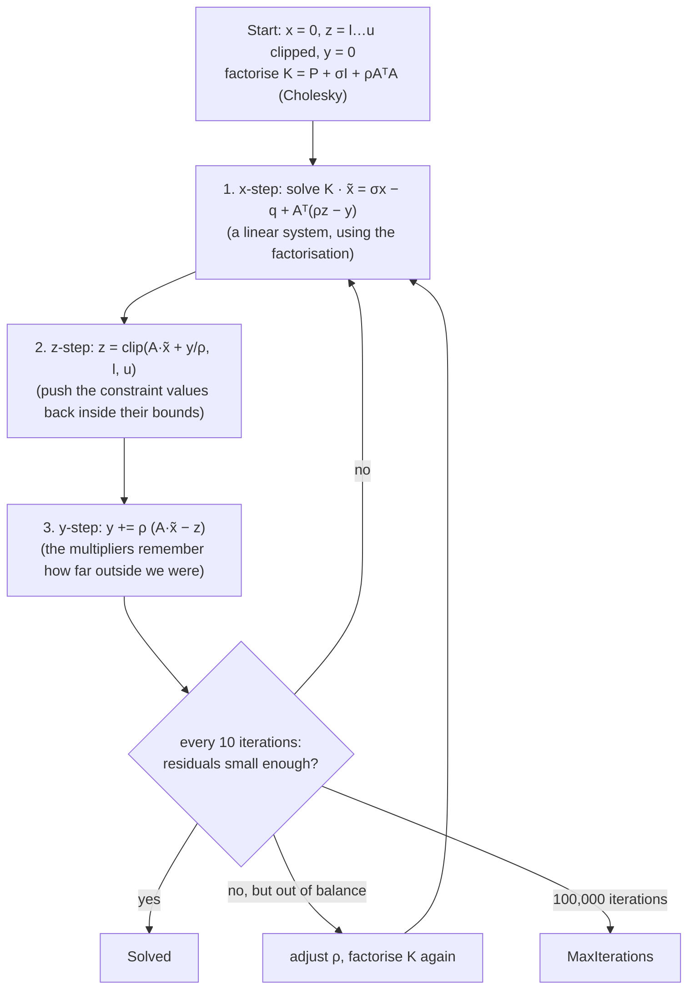

The code is a direct transcription: `cholesky` and `chol_solve` solve the linear system,
`mat_vec` / `mat_t_vec` multiply by `A` and `Aᵀ`, and the main loop in `solve` is the three steps.
`QpStatus` says how it ended (`Solved`, `MaxIterations`, `NumericalFailure`).

### 4.6 Optimising one tracker (`optimize_at` and the status)

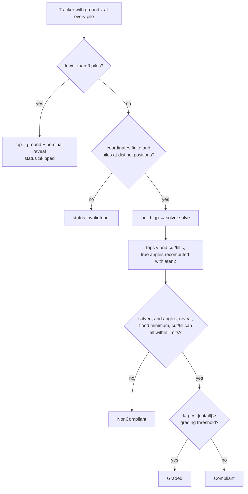

The result, `TrackerResult`, holds the status and, for each pile, a `PileResult`: top, cut/fill,
new ground, final reveal, angle change, outlier flag, whether the top sits on its flood minimum,
and the set-out position.

### 4.7 Set-out: new pile positions (`setout.rs` and `optimize_tracker`)

The layout gives the distance between two piles equal to the **length of the torque-tube span**
between them, as if the ground were flat. When the two tops differ in height by `dz`, the tube
(length `L`) covers only `√(L² − dz²)` in plan, so the piles must move slightly along the tracker:

```text
          top i+1 ●
                 ╱│
          L    ╱  │ dz          plan length = √(L² − dz²)  <  L
             ╱    │
    top i  ●──────┘
           ◄──────►
           plan length
```

`set_out(tracker, tops)` keeps one pile fixed (the **anchor**: the motor pile if the tracker has
exactly one, recognised by a type such as `HMP-20` or a description containing "motor"; otherwise
the middle pile) and walks outwards in both directions, placing each next pile at the plan length
of its span. Each pile's **shift** is its new position minus its design position along the
tracker.

Moving the piles changes the distances, which slightly changes the best tops, which changes the
positions again. `optimize_tracker` therefore repeats until the positions stop moving:

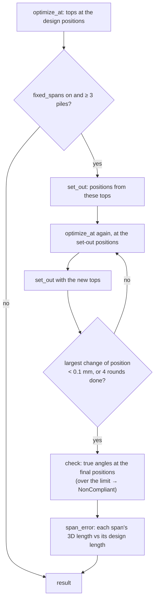

### 4.8 Many trackers at once (`optimize_all`)

Trackers are independent, so `optimize_all` shares them between threads. A shared counter
(`AtomicUsize`) hands out the next tracker number to whichever thread is free; each thread keeps
its results with their numbers, and they are put back in order at the end. With one thread (the
browser version) it is a plain loop. The 2,792 trackers of the project take about 0.2 s on two
cores.

### 4.9 The command-line tool (`top-cli`, `csv.rs`)

`top` reads a CSV of piles (`csv::read_piles`), groups them, runs `optimize_all` and writes one CSV
line per pile (`csv::write_results`), then prints a summary. It is the original tool, kept for
scripts and comparisons; the application does not use it.

---

## 5. top-db: the master database

`top-db` is where most of the application lives. Its centre is the `Store` struct
(`store.rs`), which owns the connection to one SQLite database and offers methods such as
`import_file`, `optimize`, `state` and `summary`.

### 5.1 The database file (`schema.sql`)

SQLite is a database engine that keeps a whole database in one ordinary file, with no server.
`schema.sql` creates the tables (and is run every time a database is opened: every statement
says `IF NOT EXISTS`):

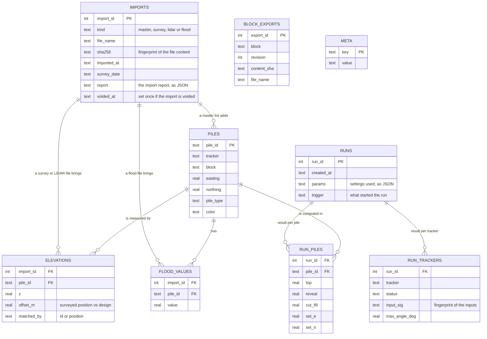

The rules of the project are enforced **by the database itself**, with *triggers* (small rules
SQLite runs before or after a change), so no bug in the program can break them:

```sql
CREATE TRIGGER IF NOT EXISTS piles_immutable_update BEFORE UPDATE ON piles
BEGIN
    SELECT RAISE(ABORT, 'the master pile list is immutable');
END;
```

- `piles` can only receive new rows: never changed, never deleted (the immutable core);
- `imports` are never deleted; the only allowed change is voiding a survey/LIDAR/flood import,
  once (`imports_void_only`);
- `elevations`, `flood_values`, `runs`, `run_trackers`, `run_piles`, `block_exports` are
  append-only.

The `meta` table is a small key → value store: `schema_version`, `settings` (JSON), `settings_at`,
`export_profiles`, `watch_folder` (this computer's), `revision` and `sync_base` (sharing, 5.10),
`saved_by` / `saved_at`.

### 5.2 Opening a database (`Store::open`, `from_bytes`, `init`)

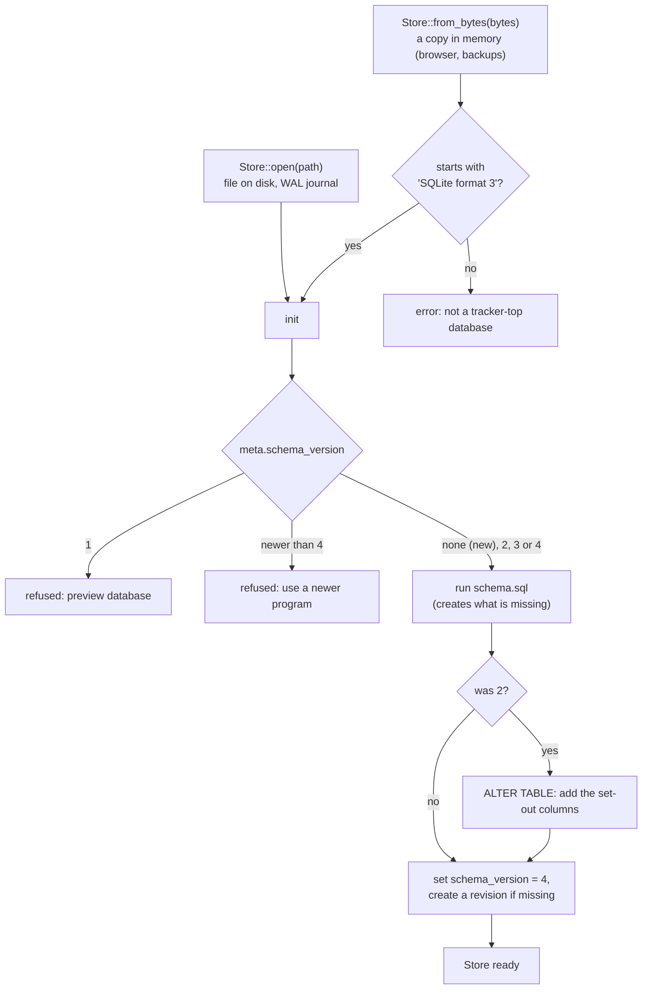

*WAL* (write-ahead log) is an SQLite mode that makes writing safer and faster for a file on
disk; it creates the companion files `tracker-top.db-wal` and `-shm` next to the database.

### 5.3 Reading a file (`table.rs`)

Survey files come from many instruments and programs, so `read_table(file_name, bytes)` is
deliberately tolerant. It returns a `Table`: header names plus rows of text cells.

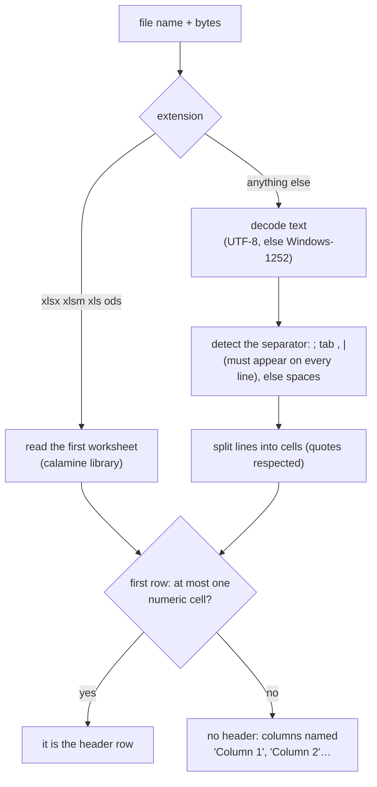

Columns are then found by name. `Col` lists the logical columns (`PileId`, `Easting`,
`Elevation`, …) and, for each, the accepted spellings. Headers are compared after
`norm_header`, which lower-cases, removes accents, spaces and punctuation: `"Z LIDAR (m)"`
becomes `"zlidarm"`, and a trailing `m` (metres) is accepted. `parse_num` reads `1234.5`,
`1 234,5` and `1,234.5` alike.

### 5.4 Importing (`Store::import_file`)

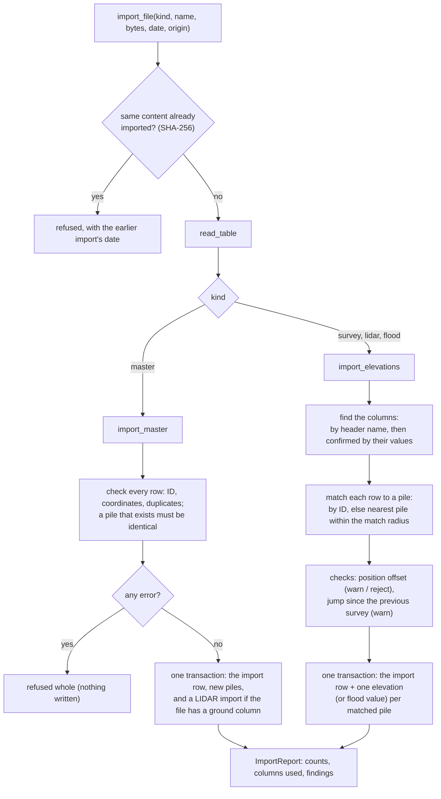

Things worth knowing in `import_elevations`:

- **Columns recognised by their values.** A survey export may have no header, or the pile ID in
  the last column. The code counts, for every column, how many cells contain a pile ID of the
  master list (`PileIndex::find_in_cell`, which also finds `P01.02.03.04` inside `P01.02.03.04_TOP`)
  and keeps the best column. Easting and Northing are the numeric columns whose values equal the
  matched piles' design coordinates (which also detects swapped X/Y). The elevation is the
  remaining numeric column whose typical value is closest to the elevations already known (else
  the first numeric column after Easting and Northing). Each such decision is written
  in the report as an *info* finding.
- **`PileIndex`** finds the nearest pile quickly by putting piles into a grid of square cells
  (a *spatial hash*): only the cells around a point are searched, not 37,000 piles.
- **The report** (`report.rs`) groups identical messages and keeps up to 25 examples of each,
  with their line numbers, so a file with 300 bad rows gives one readable line, not 300.
- **Transactions**: all rows of an import are written together, or none are
  (`self.conn.transaction()` … `tx.commit()`).

### 5.5 Which elevation is used for a pile (`latest_elevations`)

A pile may have several elevations (LIDAR, then one or more surveys). One SQL query reads them
all, ordered so that the one to use comes first for each pile, and the code keeps the first:

```sql
ORDER BY e.pile_id,
         CASE i.kind WHEN 'survey' THEN 0 ELSE 1 END,              -- surveys before LIDAR
         COALESCE(i.survey_date, substr(i.imported_at, 1, 10)) DESC, -- newest survey date first
         e.import_id DESC                                           -- then the latest import
```

Voided imports are excluded (`WHERE i.voided_at IS NULL`), which is how voiding a survey brings
back the previous value.

### 5.6 Optimising only what changed (`Store::optimize`)

Re-optimising 2,792 trackers after a survey of 300 piles would be wasteful. Each tracker gets an
**input signature**: a SHA-256 fingerprint of the settings that affect results, and of every
pile's coordinates, elevation (and which import it came from) and flood value
(`input_sig`). A tracker is recomputed only if its signature differs from the one stored with
its latest result.

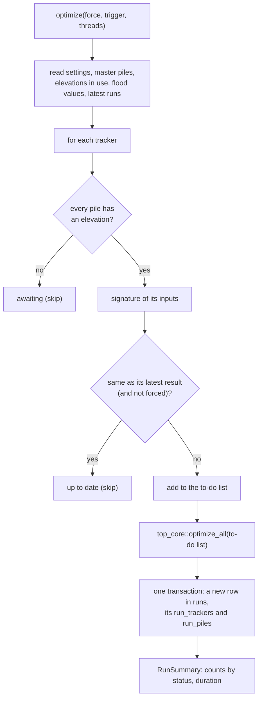

The current result of a tracker is simply its **latest run** (`latest_runs`). Old results are
never deleted, so the history of every tracker is kept.

### 5.7 The current state and the summary (`state`, `summary`)

`state()` puts everything together for the page and the exports: a `PileState` per pile
(design data, elevation in use and its source, flood values, latest result) and a `TrackerState`
per tracker (counts, status, whether the result is **stale**: computed from other elevations or
settings than the current ones). `summary()` counts from it: piles surveyed, statuses, blocks,
the **average reveal** (mean of every pile's result reveal, with the lowest and highest, and the
mean over surveyed piles only), and the average reveal per block.

### 5.8 Exports (`export.rs`, `gpkg.rs`) and settings (`settings.rs`)

- **`export.rs`**: `COLUMNS` lists the 30 columns of the *Piles* sheet, each with a key
  (`"top"`), a header (`"ToP"`) and a group. `pile_cells` computes a row of cells for one pile.
  An `ExportSpec` says which columns, blocks and sheets to export (empty = all); `workbook_with`
  writes the Excel file with the `rust_xlsxwriter` library, `piles_csv_with` the CSV. **Export
  profiles** (`ExportProfile`: a name, columns, sheets) are stored as JSON in `meta`.
- **`gpkg.rs`**: a GeoPackage is itself an SQLite database with standard tables. The code
  creates one in memory, writes the required tables (`gpkg_spatial_ref_sys`, `gpkg_contents`,
  `gpkg_geometry_columns`), the coordinate-system definition, and the `piles` (3D points) and
  `trackers` (3D lines) tables with geometries encoded by hand in the standard binary format
  (WKB), then returns the file's bytes.
- **`settings.rs`**: `Settings` holds every project setting with its default, `validate()` checks
  them, `params()` converts them into `top_core::Params`, and `params_json()` lists the ones that
  change results (part of every input signature, so changing them re-runs every tracker).

### 5.9 Installers' files (`blocks.rs`)

`block_status()` looks at each block:

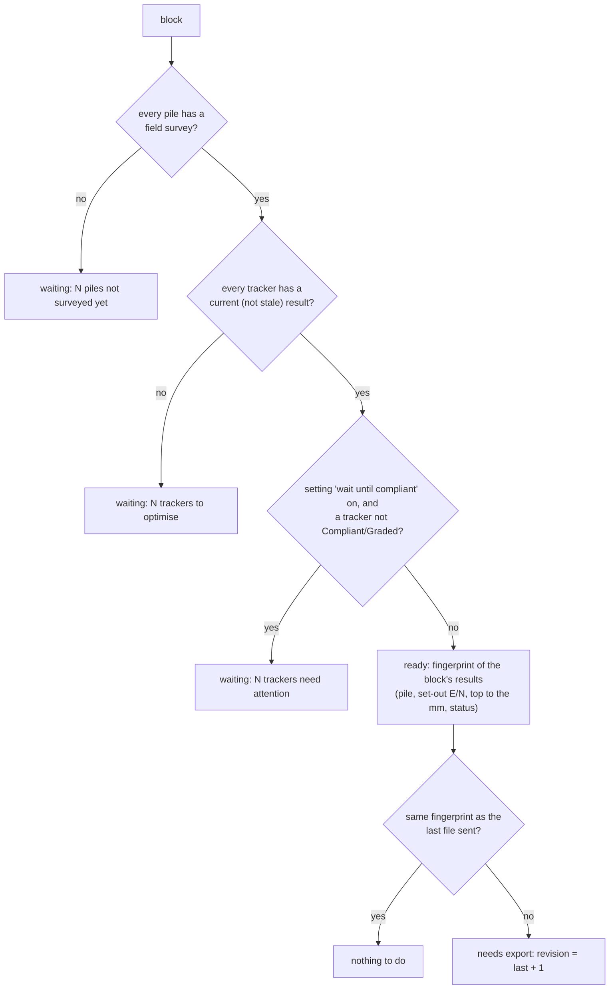

`block_workbook(block)` builds the file with the installers' profile and an *About* sheet;
`record_block_export` writes a row in `block_exports` once the page has saved the file in the
shared folder (refusing if the block changed in between). The fingerprint deliberately ignores
the run number, so re-optimising with the same results does not produce a new revision.

### 5.10 Sharing one database (`sync.rs`)

There is no server: each computer keeps its own copy and exchanges the whole file with a shared
folder. Two values in `meta` make this work:

- **`revision`**: a random 16-character value, replaced by **triggers** at every change worth
  sharing (an import, a void, a run, settings, export profiles, an installers' export). Changing
  this computer's watch folder does not change it. The triggers use a plain `UPDATE`, because
  SQLite applies the conflict rule of the statement that fires a trigger to the trigger's own
  statements.
- **`sync_base`**: the revision of the shared copy this computer last took or wrote. If
  `revision ≠ sync_base`, this computer has changes the shared copy does not have ("dirty").

When the page brings a copy of the shared file (`Store::incoming`):

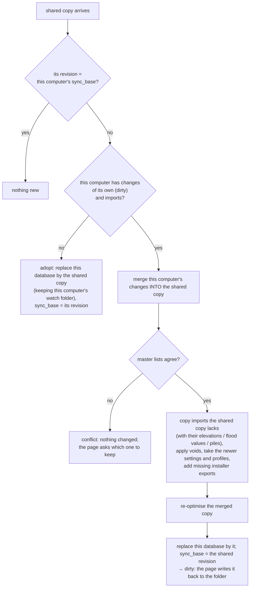

Merging is safe because nothing is ever edited in place: imports are only added or voided, so
the merge is a union. An import is "the same" on both sides when its kind, file fingerprint and
import time match; a file imported separately on both computers is kept once.

Replacing the database (`replace_with`) uses SQLite's *backup* function for a file on disk, and
loads the bytes directly for a database in memory. The browser's SQLite uses 8 KB pages and the
desktop's 4 KB pages; a file in WAL mode cannot take a copy with another page size, so the file
leaves WAL mode for the copy and goes back to it afterwards.

Writing to the folder: `snapshot(by)` returns the database's bytes (marked "saved by"), the page
writes them, then `mark_saved()` sets `sync_base` to the revision of that snapshot.

### 5.11 The request handler (`api.rs`)

`handle(store, host, request) -> Response` is a single `match` on the method and the path:

| Request | Does |
|---|---|
| `GET summary` | summary, settings, installers' status of each block |
| `GET state` | every pile and tracker, as parallel arrays (compact for 37,000 piles) |
| `POST import?kind=…&name=…&date=…` | import the body (the file), then optimise |
| `GET imports`, `GET imports/{id}`, `POST imports/{id}/void` | history, report, void (then optimise) |
| `POST optimize` | optimise (`{"force": true}`: every tracker) |
| `GET settings`, `PUT settings` | read / save settings (then optimise) |
| `GET export.xlsx`, `export.csv` | exports; `?spec=` (JSON) or `?profile=` for a custom export |
| `GET export.gpkg`, `GET backup.db` | GeoPackage, copy of the database |
| `GET export/options`, `PUT export/profiles` | columns, sheets, blocks, profiles |
| `GET blocks`, `GET export/block.xlsx?block=`, `POST export/block_done` | installers' files |
| `GET sync/status`, `POST sync/incoming`, `sync/snapshot`, `sync/saved`, `sync/adopt` | sharing |
| `GET file_seen?kind=&sha=` | was this file already imported (watch folder in the browser) |

```rust
match (method.as_str(), path) {
    ("GET", "summary") => { /* ... */ }
    ("POST", "import") => {
        let kind = Kind::parse(&kind_s).ok_or_else(|| bad(format!("unknown import kind \"{kind_s}\"")))?;
        let report = store.import_file(kind, &name, req.body, date.as_deref(), &origin).map_err(bad)?;
        // ... optimise if accepted, answer { report, run } as JSON
    }
    // ...
    _ => Err((404, format!("no such request: {method} /api/{path}"))),
}
```

Every branch returns `Ok(Response)` or `Err((status, message))`; errors become
`{"error": "message"}` with that HTTP status, which the page shows in a red message.

---

## 6. top-app: the desktop program

`tracker-top.exe` is a small web server that runs on the user's computer and opens the page in
their browser. Everything happens locally: the page talks to `http://localhost:8770`.

### 6.1 Start-up (`main.rs`)

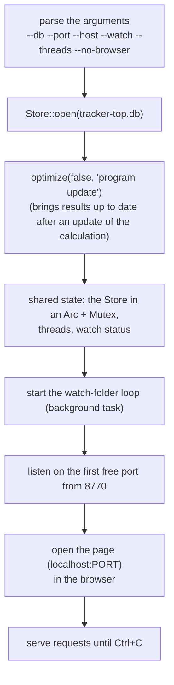

`main` is marked `#[tokio::main]`, which starts the `tokio` runtime that lets the server wait for
many connections at once (3.10).

### 6.2 Answering a request (`api.rs`, `assets.rs`)

The router has two rules: `/api/...` goes to the `api` function, anything else is a file of the
page, found in `assets.rs`. The page's files (`index.html`, `app.js`…) are built into the
executable with `include_bytes!`, so the program is a single file that works offline.

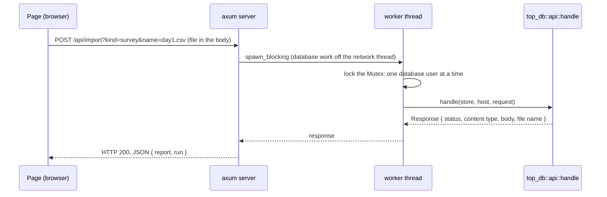

For downloads, the response carries a file name, sent as a `Content-Disposition` header (with
the name encoded so that any characters work).

### 6.3 The watch folder (`watch.rs`)

A background loop, every 30 seconds:

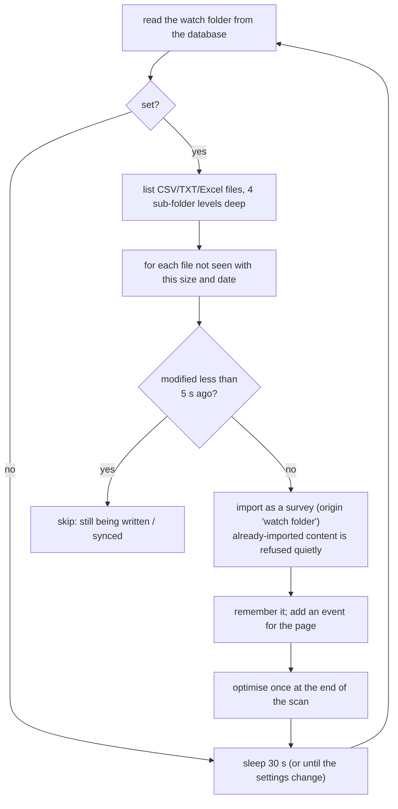

---

## 7. top-web: the browser version

The browser version is the same Rust code compiled to **WebAssembly** (WASM), a format every
modern browser can run at near-native speed. There is no server: the page, the engine and the
database are all in the browser.

### 7.1 The engine (`crates/top-web/src/lib.rs`)

`#[wasm_bindgen]` marks what JavaScript may call. The engine is a thin wrapper around a `Store`
held in memory:

```rust
#[wasm_bindgen]
pub struct Engine {
    store: Store,
}

#[wasm_bindgen]
impl Engine {
    #[wasm_bindgen(constructor)]
    pub fn new(saved: Option<Vec<u8>>) -> Result<Engine, JsError> { /* from_bytes, or empty */ }

    /// One API request, as the page would send it to the desktop program.
    pub fn request(&mut self, method: &str, path: &str, query: &str, body: &[u8], watch: &str) -> Reply {
        // ... calls top_db::api::handle, exactly like the desktop server
    }

    /// The database file, to store or download.
    pub fn save(&mut self) -> Result<Vec<u8>, JsError> { self.store.to_bytes().map_err(js) }
}
```

`Reply` carries the status, content type, file name, body, and `changed` (the request modified
the database, so it must be stored).

### 7.2 The worker and the bridge (`www/worker.js`, `www/browser.js`)

Long calculations would freeze the page, so the engine runs in a **Web Worker** (a background
thread of the browser). The database is kept in the browser's **IndexedDB** storage and saved
after every change.

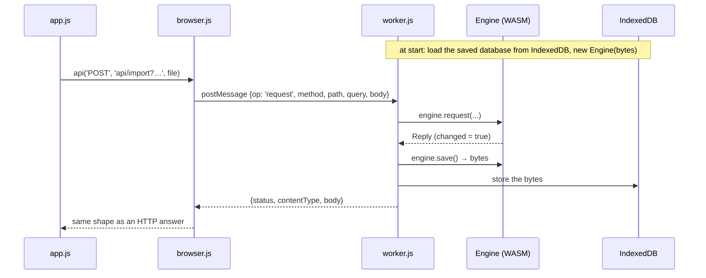

`browser.js` also handles downloads (it turns the bytes into a file the browser saves), opening
or resetting the database, and the watch folder (with the browser's folder access, Edge/Chrome).

### 7.3 Building it (`scripts/build-web.sh`)

1. `cargo build --release --target wasm32-unknown-unknown -p top-web` compiles to WebAssembly.
2. `wasm-bindgen` generates the JavaScript glue (`pkg/top_web.js`) for the `#[wasm_bindgen]`
   items.
3. The page's files and `worker.js` / `browser.js` are copied next to it, and one line is added
   to `index.html`: `window.TRACKER_TOP_BROWSER = true`, which tells `app.js` to use the worker
   instead of HTTP.

SQLite itself is C code; the `sqlite-wasm-rs` library provides it compiled for the browser.

---

## 8. The web page (JavaScript)

The interface is plain JavaScript modules, with no framework, in `crates/top-app/web/`.

| File | Role |
|---|---|
| `index.html` | the tabs and static parts of each page |
| `style.css` | colours (light and dark themes), layout |
| `app.js` | everything else: API calls, the tabs, import, results, history, settings, custom export, the shared-database cards |
| `sync.js` | the shared database: moving the file to and from the folder or Google Drive |
| `view3d.js` | the 3D view (three.js): pile markers, tracker lines, a ground surface triangulated with delaunator |
| `profile.js` | the profile chart of a tracker (SVG) |
| `config.js` | settings of the installation (the Google client ID) |

### 8.1 `app.js` in short

- `api(method, url, body)` sends a request and returns the JSON answer, through HTTP (desktop) or
  the worker (browser). `apiRaw` does the same for files (bytes and file name). After any request
  that changes the database, `api` tells the shared-database module (`sync.changed()`).
- `cache` keeps the last summary and state; `refresh()` reloads them and redraws.
- `renderers.overview`, `renderers.results`, … draw each tab; `show(tab)` switches tab (the tab
  is also in the address, e.g. `#results`).
- `poll()` checks every 15 s whether the database changed in the background (watch folder) and
  redraws.

### 8.2 `sync.js`: the shared database

Two **targets** with the same three operations, `stat(path)` (a stamp that changes when the file
changes), `read(path)` and `write(path, bytes)`:

- `FolderTarget`: a folder on the computer, through the browser's File System Access API
  (`showDirectoryPicker`); the stamp is the file's modification time and size;
- `DriveTarget`: Google Drive's web API, after signing in with Google Identity Services; the stamp
  is the file's MD5 checksum; uploads use Drive's *resumable* upload (needed above 5 MB).

The exchange, after every change, every 30–60 s and when the window gets the focus:

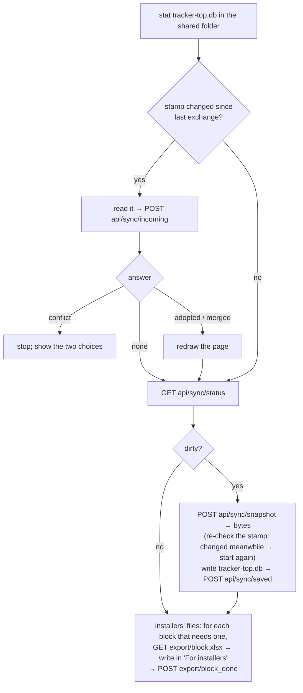

The settings of the target (which folder, the computer's name) are this computer's own, kept in
the browser's IndexedDB (`tracker-top-sync`), not in the shared database. `navigator.locks`
prevents two tabs of the same page from exchanging at the same time.

---

## 9. Tests

```
cargo test --workspace          # every test (about 70), a few seconds
cargo test -p top-db sync       # only the tests of top-db whose name contains "sync"
```

| Where | What is tested |
|---|---|
| `top-core/src/qp.rs` | the solver on problems with a known answer |
| `top-core/src/optimize.rs` | flat, sloped, dipped terrain; random trackers; parallel = serial; flood minimum; set-out |
| `top-core/src/setout.rs` | motor pile detection, span lengths kept, angles at the new positions |
| `top-db/src/table.rs` | separators, decimal commas, headerless files, Latin-1, quotes, header spellings |
| `top-db/src/store.rs` | imports of every kind, immutability, duplicates, matching, voiding, incremental runs, settings, flood, set-out, upgrades of old databases, exports |
| `top-db/src/sync.rs` | revisions; taking, merging and conflicts between copies; disk and browser copies with different page sizes |
| `top-db/src/blocks.rs` | installers' files and revisions, export profiles, custom columns, average reveal |
| `top-db/src/api.rs` | requests end to end, database copy and restore |

A test is an ordinary function that builds a small situation and checks the outcome. For example
(`sync.rs`):

```rust
#[test]
fn a_new_computer_takes_the_shared_copy() {
    let mut a = master();                       // a database with a small master list
    survey(&mut a, "s1.csv", &[("A1.1", 10.0), ("A1.2", 10.1), ("A1.3", 10.2)]);
    let shared = save(&mut a, "site office");   // what computer A writes to the folder

    let mut b = Store::open_in_memory().unwrap();   // computer B, empty
    let rep = b.incoming(&shared, "laptop", 1).unwrap();
    assert_eq!(rep.action, "adopted");
    assert_eq!(files(&b), files(&a));           // same imports
    assert_eq!(tops(&b), tops(&a));             // same results
}
```

Tests that need a real browser (the page, the browser version, the shared folder between the
desktop and browser versions) were run with Playwright scripts outside the repository; their
results are listed in the README under *Verification done*.

---

## 10. Building, continuous integration and releases

```
cargo build --release                  # target/release/tracker-top and target/release/top
cargo run -p top-app -- --db test.db   # build and run the desktop program
scripts/build-web.sh                   # the browser version, into target/web-dist/
cargo clippy --workspace               # advice on the code
cargo fmt                              # format the code the standard way
```

For Windows from Linux (how the `.exe` sent by e-mail was built):

```
rustup target add x86_64-pc-windows-gnu          # once; needs mingw-w64 installed
CARGO_TARGET_X86_64_PC_WINDOWS_GNU_LINKER=x86_64-w64-mingw32-gcc \
  cargo build --release --target x86_64-pc-windows-gnu -p top-app
```

On GitHub (`.github/workflows/`):

- `build.yml`: on every push to `main` and every pull request, builds and tests on Windows, macOS
  and Linux and keeps the programs as downloadable *artifacts*; a tag such as `v0.6.0` also
  creates a release with them.
- `pages.yml`: builds the browser version and publishes it with GitHub Pages on every push to
  `main`.

The version number is in the workspace `Cargo.toml` (`version = "0.6.0"`); the page shows it.

---

## 11. Recipes: how do I…

**…add a column to the exports?**
In `crates/top-db/src/export.rs`, add a `col("key", "Header", "Group")` line to `COLUMNS`
(and change the array length `[Column; 30]`), and the matching cell in `pile_cells`, at the same
position. If the value is new, add it to `PileState` in `store.rs` and fill it in `state()`. The
custom export dialog and profiles pick it up automatically. Run `cargo test`: the test
`custom_csv_has_the_chosen_columns_and_blocks` checks the column count.

**…add a setting?**
Add the field with a comment in `Settings` (`crates/top-db/src/settings.rs`) and its value in
`Default`; check it in `validate()`. If it changes optimisation results, add it to `params()` (and
`top_core::Params`) and to `params_json()`. Old databases get the default automatically
(`#[serde(default)]`). Then add an input in the Settings form of `index.html` and read/write it in
`renderers.settings` and the form's `submit` handler in `app.js`.

**…accept a new header spelling in survey files?**
Add it, normalised (lower case, no spaces or punctuation: "Pt No." → `"ptno"`), to the right list
in `Col::aliases` (`crates/top-db/src/table.rs`). Earlier entries win when several columns match.
Add a test in the same file.

**…add a request to the API?**
Add a branch to the `match` in `route` (`crates/top-db/src/api.rs`), for example
`("GET", "my/thing") => ok(json!(store.my_thing().map_err(bad)?)),`. Both the desktop and the
browser versions get it. Call it from the page with `await api('GET', 'api/my/thing')`.

**…change the database structure?**
Add `CREATE TABLE IF NOT EXISTS …` (or a trigger) to `schema.sql`; that is enough for new tables.
To add a column to an existing table, increase `SCHEMA_VERSION` in `store.rs` and add an
`ALTER TABLE` step in `init` for databases of the previous version (see how version 2 is
upgraded). Add a test that opens a database of the previous version
(`version_2_database_is_upgraded_in_place` shows how). Remember that every computer sharing a
database must then be updated.

**…change the optimisation (objective or a new rule)?**
The problem is assembled in `build_qp` (`crates/top-core/src/optimize.rs`): a new linear rule is
one more row in `A` with its bounds `l` and `u` (update the row count `m`). The independent check
after the solve (`optimize_at`) should test the new rule too, and `params_json()` should get a new
`"method"` number so that every tracker is recomputed. Add a test in `optimize.rs`.

**…find out why a survey file is not read as expected?**
Import it and read the import report: it says which column was used for what and why (header
name, or "recognised from its values"), and lists skipped rows with their line numbers. To
reproduce it in a test, copy the file's first lines into a test in `store.rs`
(`survey_columns_recognised_from_values` is a good model).

---

## 12. Glossary

| Term | Meaning |
|---|---|
| **ToP** | top of pile: the elevation of the top of a pile |
| **reveal** | height of the pile above the ground: ToP − ground |
| **cut / fill** | lowering / raising the ground at a pile so that the reveal and angle limits can be met |
| **chainage** | distance along a tracker from its first pile |
| **span** | the piece of torque tube between two consecutive piles |
| **motor pile** | the pile carrying the tracker's drive; the set-out keeps it at its design position |
| **set-out** | the position where a pile is to be installed, given to the surveyors |
| **QP** | quadratic programme: minimise a sum of squares under linear limits |
| **ADMM** | the iterative method the solver uses |
| **crate** | a Rust library or program |
| **trait** | a Rust interface: methods a type promises to have |
| **borrow** (`&`, `&mut`) | lending a value to a function without giving it away |
| **`Result` / `?`** | Rust's way to return errors and pass them on |
| **SQLite** | a database engine that keeps a whole database in one file |
| **trigger** | a rule the database runs automatically when rows are changed |
| **transaction** | a group of database changes applied all together or not at all |
| **WAL** | write-ahead log: an SQLite mode for files on disk |
| **SHA-256** | a fingerprint of some data: identical content gives an identical fingerprint |
| **WebAssembly (WASM)** | compiled code that runs inside a web page |
| **Web Worker** | a background thread of a web page |
| **IndexedDB** | the browser's storage for web pages |
| **revision / sync_base** | how copies of a shared database tell whether they are in step (5.10) |
| **GeoPackage** | a GIS file format (an SQLite file with standard tables), read by ArcGIS and QGIS |
